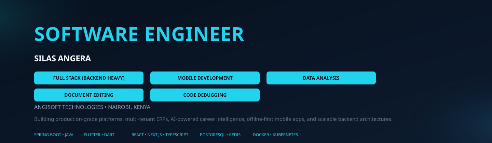
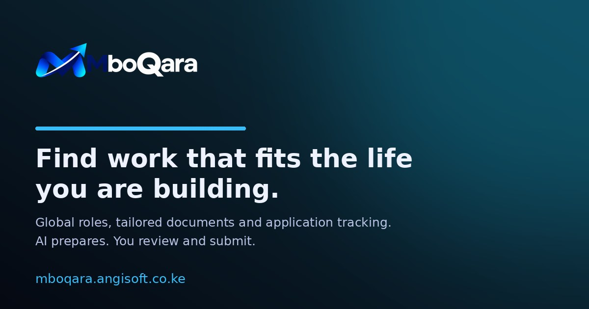
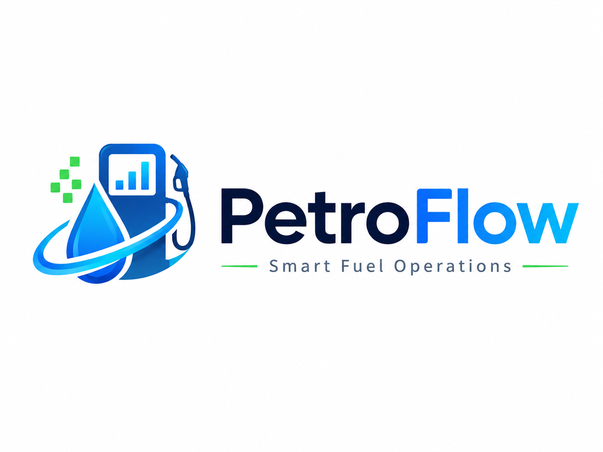
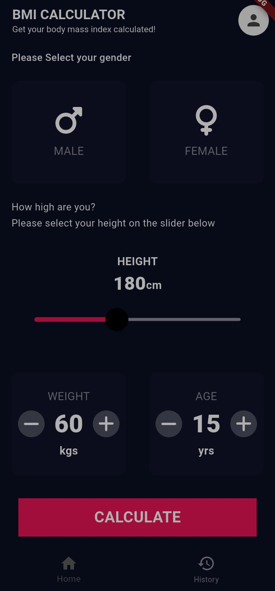
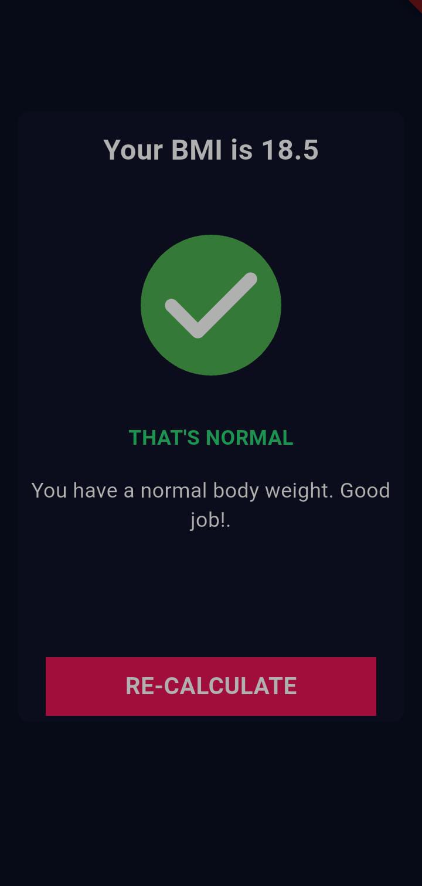
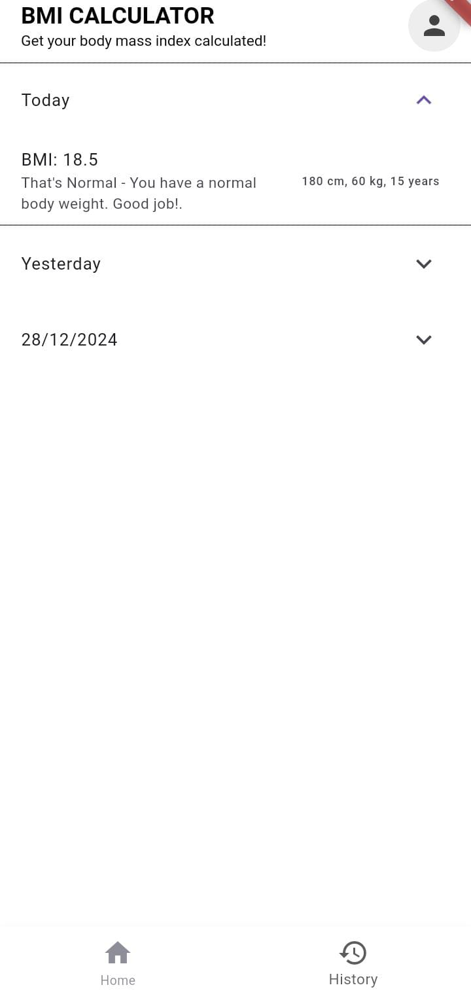

# 

---

## Technology Expertise

| Languages | Backend & APIs | Frontend & Mobile | Data, DevOps & Cloud |
|:---------:|:--------------:|:-----------------:|:--------------------:|
|       |       |       |       |

---

## Featured Projects

### MboQara — AI Career Intelligence Platform
**`AngiSoft-Technologies/ai-career-platform`**  •  **Live:** [mboqara.angisoft.co.ke](https://mboqara.angisoft.co.ke)  •  **Stack:** Flutter, Dart, Next.js 16, React 19, TypeScript, Tailwind CSS 4, Neon Auth, PostgreSQL, BullMQ, Redis

AI-powered career platform for job seekers — discovers live roles across job boards, scores matches against your profile, generates tailored CVs and cover letters, tracks every application end-to-end. Offline-first Flutter mobile app with SQLite + background sync. Neon Auth (Managed Better Auth) with Google OAuth. Real-time job matching via Neon AI Gateway.

---

### PetroFlow Platform — ERP for Petroleum Stations
**`Angera-Silas/petroflow-web`** + **`petroflow-backend`** + **`petroflow-mobile`**  •  **Stack:** React 19, TypeScript, Vite, Tailwind CSS, Spring Boot 3.4, Java 17, PostgreSQL, Redis, Docker, JWT, Firebase

| Web Dashboard | Mobile App | Backend Architecture |
|:-------------:|:----------:|:---------------------|
|  |  | Multi-tenant, schema-per-org |

Centralized ERP for petrol station operations — real-time sales dashboards, inventory tracking with low-stock alerts, employee/shift management, incident reporting with approval workflows, multi-outlet coordination for dealer networks. Offline-sync orchestration with conflict resolution (last-write-wins). RBAC: Attendant / Manager / Admin / Super-Admin. Audit-grade logging for compliance.

---

### AngiSoft Platform — Multi-Tenant Platform Architecture
**`Angera-Silas`** (private workspace)  •  **Stack:** Spring Boot 3, Java 17, PostgreSQL (Neon), Redis, Docker, Kubernetes, Liquibase, Spring Security, OpenTelemetry

Core platform powering multiple AngiSoft products (DukaFlow, PetroFlow, KejaLink, AngiTunes):
- **Identity & Tenancy** — Organizations, schema-per-tenant isolation, automated provisioning
- **Commerce** — Billing, payments (Stripe, M-Pesa), entitlements, subscriptions
- **Developer Services** — SDKs, file storage (S3/Tigris), events, webhooks, notifications
- **Security & Audit** — RBAC, audit trails, request rate limiting, encrypted secrets

---

### Basic Health Information System
**`Angera-Silas/basic-health-information-system`**  •  **Stack:** Flutter (Web, Desktop, Mobile), Dart, Spring Boot, PostgreSQL, Docker

Comprehensive healthcare platform for client and program management — real-time client search, program enrollment, detailed client profiles with enrolled programs. Flutter frontend with Spring Boot backend. RESTful API with role-based access. Containerized deployment with Docker Compose.

---

### BMI Calculator — Flutter Showcase
**`Angera-Silas/bmi_calculator`**  •  **Stack:** Flutter, Dart, Custom Widgets, Theming, SQLite

Modern BMI calculator demonstrating advanced Flutter widget customization — custom theming, multi-screen navigation, gesture detection, enums for state management, responsive design across screen sizes. Inspired by Ruben Vaalt's Dribbble design.

<table>
<tr>
<td align="center"> Input Screen</td>
<td align="center"> Results Screen</td>
<td align="center"> History Screen</td>
</tr>
</table>

---

### AngiSoft Technologies Website
**`AngiSoft-Technologies/company_portfolio`**  •  **Live:** [angisoft.co.ke](https://angisoft.co.ke)  •  **Stack:** React 19, Vite 7, Tailwind CSS 4, MUI, Redux Toolkit, Express, TypeScript, Prisma ORM, Neon PostgreSQL, BullMQ, Redis, Stripe, OpenAI

Full-stack corporate website with admin CMS — services showcase, project portfolio, staff directory, blog, client testimonials, contact/forms, booking system, client portal, Stripe checkout, AI chatbot. Deployed on Netlify (frontend) + Fly.io (backend) with Tigris storage.

---

## GitHub Ecosystem

### Contribution Activity (90 Days)

### Streak & Summary Stats

| Repositories | Stars | Followers | Organization |
|:------------:|:-----:|:---------:|:------------:|
| **53** | **29** | **23** | [AngiSoft-Technologies](https://github.com/AngiSoft-Technologies) |

---

## Open Source & Gists

Selected educational gists — Java fundamentals, Dart/Flutter patterns, VB.NET basics:

| Topic | Gists | Description |
|-------|-------|-------------|
| **Java Core** | 11 | Arrays, loops, conditionals, regex, OOP, strings, bitwise operators |
| **Dart/Flutter** | 1 | First-class functions demonstration |
| **VB.NET** | 5 | Area calculations, loops, type conversion, basic arithmetic |

---

## Professional Links

---

**Open to collaboration** — Let's build something meaningful together.

[`angerasilas@gmail.com`](mailto:angerasilas@gmail.com)  ·  Nairobi, Kenya  ·  UTC+3

---

Last updated: November 2026  •  Built with real metrics, real projects, real code.

